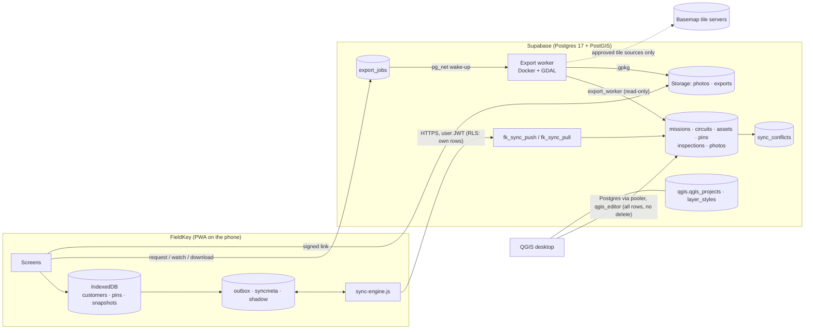

# FieldKey data architecture

Supabase PostGIS is the single source of truth. Phones work offline and sync to it; QGIS reads and
edits it directly; mission packages are GeoPackages built from it.

## Pieces

| Piece | Where | Role |
|---|---|---|
| Schema | `supabase/migrations/` | PostGIS tables, audit triggers, RLS, roles, sync and export functions. Additive only. |
| FieldKey | `index.html`, `sync-engine.js`, `export-plan.js` | Offline-first app. Saves locally, queues changes in an outbox, syncs when online. |
| QGIS project | `qgis/fieldkey_qgis_setup.py`, `docs/qgis-setup.md` | Builds the "FieldKey" project stored in the database, with forms and styles, plus FieldKey's basemaps, terrain, airspace and protected areas from their online sources. |
| Export worker | `worker/`, `docs/export.md` | Builds mission GeoPackages from queued jobs. |
| Runbook | `docs/runbook.md` | Passwords, accounts, conflicts, exports, paused project. |

## Who can see what

| Login | Sees | Can change |
|---|---|---|
| FieldKey user (Supabase Auth) | only rows with their `owner_id` | insert/update own rows (deletes are soft: `deleted_at`); request and cancel own exports |
| `qgis_editor` (QGIS) | all rows | insert/update; soft delete via the form action. No hard deletes, no auth/storage access |
| `export_worker` | all rows (filters by the job's owner) | only `export_jobs` status fields |
| Export worker's Storage key | `exports` bucket | upload/delete package files |

Secrets (database passwords, the Storage key, the worker token) live in password managers,
Google Secret Manager or Supabase Vault — never in the repo. Database passwords are set as SCRAM
hashes so plain text never reaches the database logs.

## Sync rules (summary)

- Every saved change goes into the phone's outbox; the latest edit of a row replaces an older queued one.
- Push in batches of ≤200 with retries and backoff (2 s → 30 s); the server answers per row
  (`inserted`, `updated`, `unchanged`, `stale`, `rejected`, `error`), so a retried upload is harmless.
- Pull per table after an `(updated_at, id)` cursor; rows with a pending local edit are skipped until it uploads.
- Conflicts: an edit based on an older version than the server's is concurrent; the later
  `client_updated_at` wins and the losing version is written to `sync_conflicts`.
- Deletes are soft (`deleted_at`), so delete-vs-edit follows the same rule and nothing is lost.
- Sync runs every minute, when the app comes back to the foreground, and when signal returns.

## Mapping from the original app

| Before | Now |
|---|---|
| IndexedDB `customers` | `assets` (point geometry from lat/lng; ids are uuid5 of owner + legacy id) |
| customer `assignment` (import batch name) | `missions` row, linked by `assets.mission_id` |
| `fk_userpins` in localStorage | `pins` |
| IndexedDB `snapshots` (daily) | stays on the phone (local undo); not synced |
| Settings (`fk_*` in localStorage) | stay on the phone |
| — | `circuits`, `inspections`, `photos` (tables ready; no FieldKey screens yet) |
