# FieldKey features

FieldKey is a phone app for utility and drone inspectors. It turns a day's site file into a
database on your phone, gets you access to each site (requests, texts, scheduling), and helps
you check the ground, the airspace and the weather before you fly. It runs on the website as an
installable app, and on iPhone as a native app with extra features (marked **iPhone app**).

The screenshots use made-up sites around Redding, CA, taken in the iPhone app (v84).

## What stands out

- **From KML to access requests in a minute.** Import the day's file and FieldKey finds the SAP
  ID and coordinates by itself, merges the sites into your database without losing anything you
  collected earlier, and builds copy-ready access requests. It looks up street addresses only
  for the sites you actually request.
- **Guided texting.** One tap per site: each customer's text opens with their name and address
  filled in. In the iPhone app the text goes out without leaving FieldKey, the next one opens by
  itself, and a reminder comes up if nobody replies.
- **A drone pilot's map in one place.** FAA airspace with the LAANC grid and ceilings, TFRs,
  wildfires and Red Flag Warnings, protected land, property lines, radar and rain forecast,
  3D terrain and buildings, plus go/no-go drone weather, all on the same map as your sites.
- **Works with no signal.** Save an area or a whole mission ahead of time, including aerial
  imagery with sharp close-ups around each site, terrain and topo. The app itself, your data,
  GPS and the saved maps all keep working in a dead zone.
- **Reads email replies, even messy ones.** Paste a reply and FieldKey matches each record to
  your sites by SAP ID, name or address. On newer iPhones, Apple's on-device AI also reads the
  email; nothing leaves the phone.
- **In the car.** Today's scheduled sites on the Lock Screen and, in the iPhone app, a CarPlay
  list with Directions and Call (waiting for Apple's approval).
- **Your data stays on your phone.** Everything is stored on the device first. Only coordinates
  go out for address lookup, and syncing to the team's account is optional.

## The map

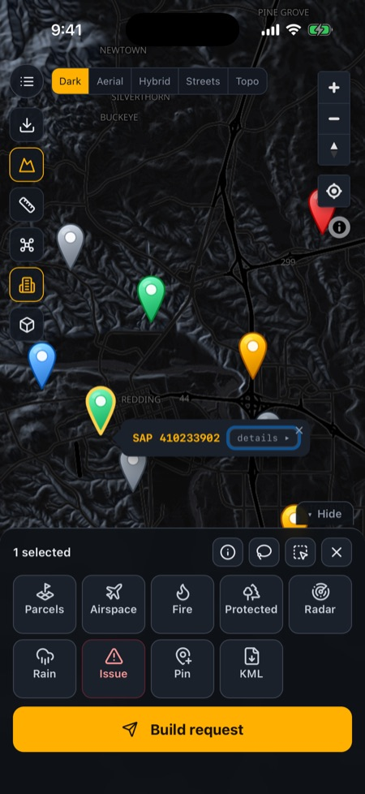 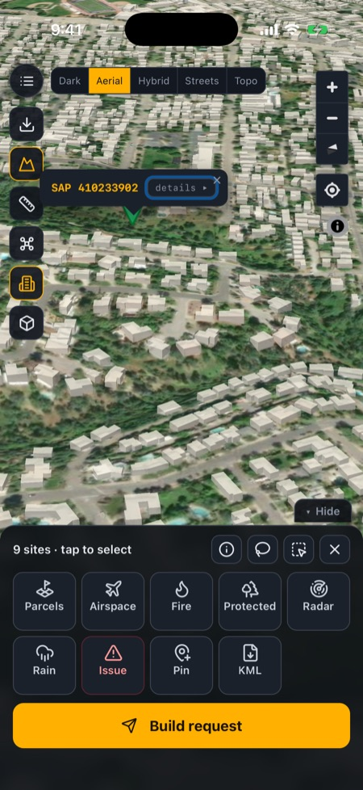 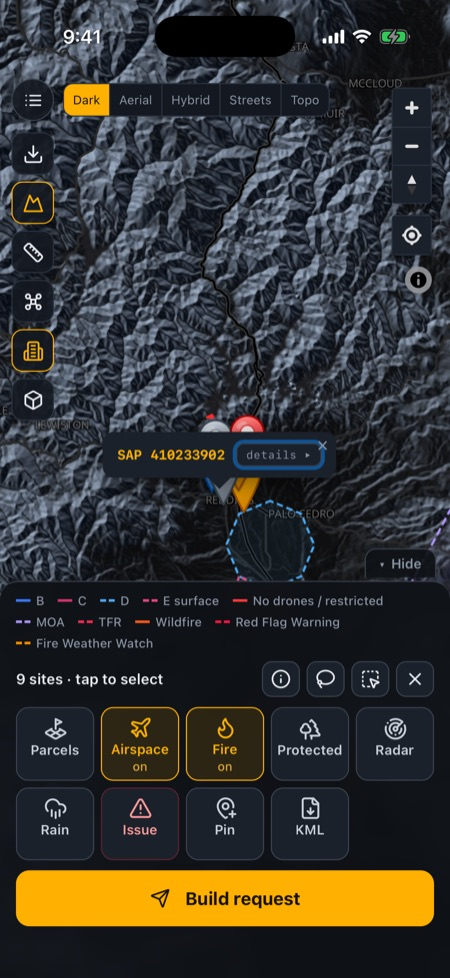

FieldKey opens on the map. Every site gets its own pin, colored by status: grey new, amber
texted, blue replied, green scheduled, red access issue. Tap a pin for its SAP ID; **details**
opens the name, access notes, directions, drone weather, 3D view and nearest hospital.

- **Five basemaps:** Dark, Aerial, Hybrid (imagery with streets), Streets and USGS Topo.
- **3D:** tilt with two fingers and the terrain rises; buildings stand up at their mapped
  heights. **3D view** opens Google's photorealistic 3D tiles of a site.
- **Select sites** by tapping pins, drawing a **lasso** around them, or **Select visible**, then
  build a request, flag an access issue or export a KML.
- **Measure** distances (feet, miles) and areas (acres).
- **Drop your own pins** for gates, parking, hazards and notes. They stay out of requests and
  exports.

**Layers for flying:**
- **Airspace:** FAA Class B, C, D and E surface areas, special-use airspace and no-drone zones.
  Zoom in and the **LAANC grid** shows the auto-approval ceiling in each square. Tap anywhere for
  what applies to a drone there; **Copy for LAANC** gets the details ready for your LAANC app.
- **TFRs:** active temporary flight restrictions with their times, altitudes and full text.
- **Fire:** NIFC wildfires and perimeters, Red Flag Warnings and Fire Weather Watches.
- **Protected:** national parks, wildlife refuges, wilderness, state parks and marine areas,
  with each one's general drone rule.
- **Property lines** for the whole US, in a color that suits the basemap.
- **Radar** (the last hour plus a forecast to about 15 hours, with a Play button) and **Rain
  forecast** (6-hour blocks to 7-day totals).

## Offline maps

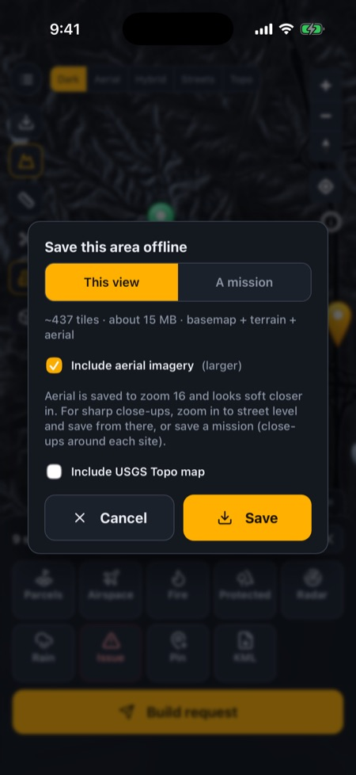

Before heading out, save **this view** or **a mission** (the map around every site in it, 150 m
to 2 km). FieldKey shows the tile count and size before it saves. A save includes the basemap,
terrain, buildings and, if you tick them, aerial imagery and USGS Topo. Missions also get
**sharp close-ups**: USDA NAIP photos around each site at zoom 17–18. **Settings → Offline maps**
lists every saved area with its size and a Delete button.

## Your sites

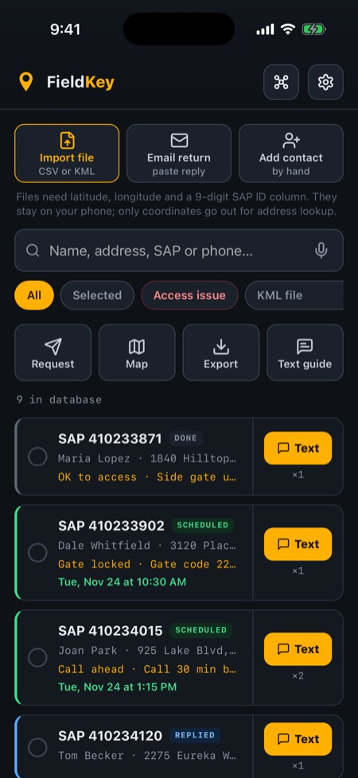 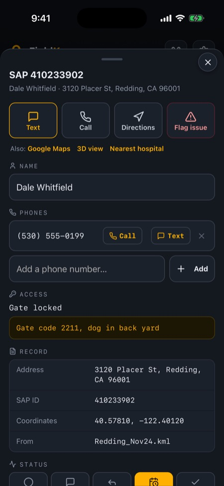

- **Import a CSV or KML.** It finds the SAP ID, latitude and longitude columns and merges by SAP
  ID, then name, then address, keeping the phones, access notes and history you already have.
  Each file is tagged, so you can filter to one day's file.
- **Search** by name, address, SAP ID or phone number (any format, or just the last digits). The
  **mic** searches by voice.
- **Filters:** all, selected, access issue, one imported file.
- **Site details:** Text, Call, Directions and Flag issue; phones, access and gate codes, the
  record, status (New, Texted, Replied, Scheduled, Done), notes and a texts-sent counter.
- **Scheduling:** pick a date and time, then add it to Apple Calendar or Google Calendar with the
  address, phone, access notes and a directions link.
- **Access issues:** flag one site or a batch with a reason (locked gate, need code, dog…). They
  stay red on the map and in the list until you clear them.
- **Nearest hospital:** the five closest hospitals with trauma level, helipad, Call and
  directions. Works offline once looked up.

## Access requests and email replies

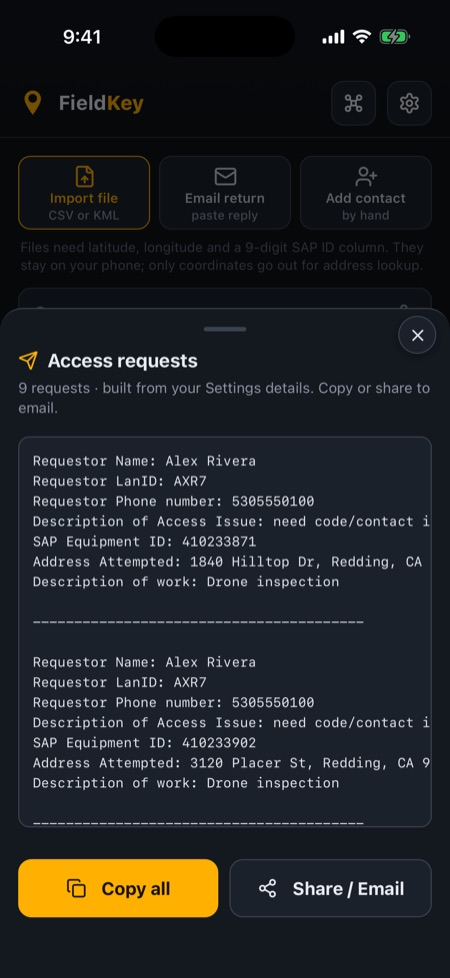 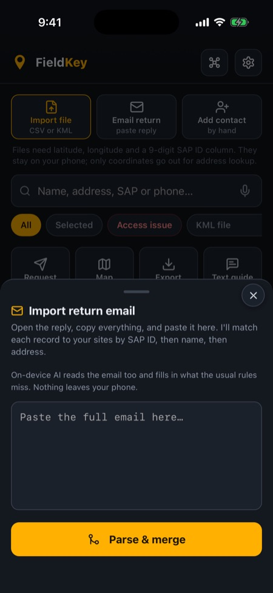

**Build request** turns the selected sites (or everything shown) into access-request text with
your requestor details from Settings: copy it all, or share it to email. Addresses are looked up
just for those sites and saved, so each site is only looked up once.

**Email return:** paste the reply and FieldKey pulls out each record's SAP ID, name, address,
phones and access details, wherever they are in the email, and merges them in. In the iPhone app
on an iPhone 15 Pro or newer, Apple's on-device AI also reads the email and fills in what the
usual rules miss. What it returns is checked against the email's own text.

## Guided texting

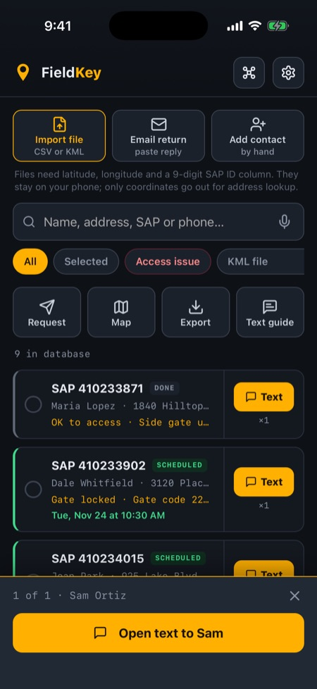

**Text guide** walks through every site you haven't texted yet. Each text uses your template
from Settings with the customer's first name and the site's address filled in.

In the **iPhone app**:
- The text opens inside FieldKey, and the site is marked texted only once it's actually sent.
  After each send, the next site's text opens by itself; **Skip** moves past one.
- **Follow-up reminders:** "No reply from Ana Ruiz · Text again?" after 4, 24 or 48 hours.
  Tapping it opens that site's text.
- **Lock Screen progress:** "Texting · 7 of 23 sent / Next: …" on the Lock Screen and in the
  Dynamic Island.
- **Siri and Shortcuts:** "Text the next site in FieldKey". It can go on the Action button.

## Drone weather (Flyability)

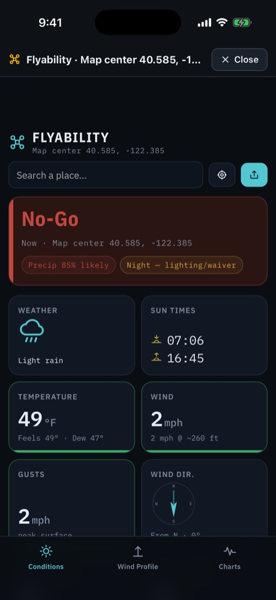

Go, caution or no-go for your location, the map center or a site, from wind, gusts, rain
chance, visibility, temperature and the Kp index, plus sun times, a 7-day outlook, wind by
altitude and charts. It uses two forecasts at once (Open-Meteo and the National Weather Service)
and goes by the worse of the two.

## In the car

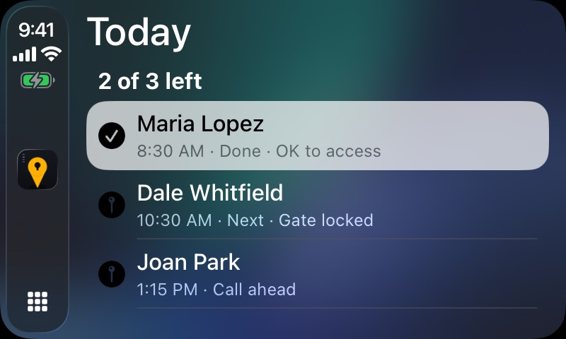 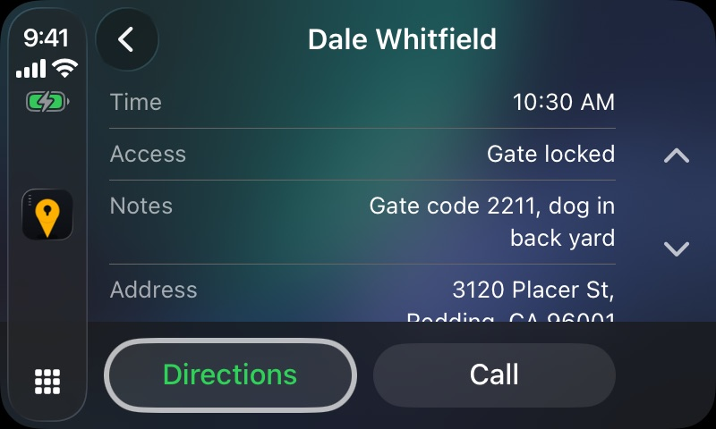

- **Today's sites on the Lock Screen (iPhone app):** "Next: Dale Whitfield · 10:30 AM / Gate
  locked · Gate code 2211 · 3120 Placer St", with done-of-total. It updates as you mark sites
  done, and on iOS 26 it also shows on the CarPlay dashboard.
- **CarPlay app (iPhone app):** today's scheduled sites, with the time, access notes and address,
  and **Directions** and **Call**. It's built, but it only appears in a car once Apple approves
  FieldKey for CarPlay (see [the iOS app doc](ios-app.md)). The screenshots are from Xcode's CarPlay simulator.

## Export, backup and sync

- **Export** the selected or shown sites as CSV (Excel), JSON, vCard (into Contacts) or KML.
- **Mission package:** one GeoPackage of chosen missions with QGIS styles, ready for a client.
  Names and phones are left out unless you include them.
- **Backups:** download one file with every site and your Settings, and restore from it.
  FieldKey also keeps a snapshot from each of the last 14 days, so you can roll back a bad day.
- **Account and sync (optional):** sign in to sync missions, sites and pins with the team's
  account and QGIS. Changes made offline upload when signal returns.

## Where it runs

- **Website:** open it in Safari or Chrome and add it to the Home Screen. It works offline once
  installed.
- **iPhone app:** built from `app/` with Xcode. Adds texting inside the app, reminders, Lock
  Screen progress, Siri, on-device AI email reading, the share sheet for exports, Apple Calendar's
  own event screen and CarPlay. See [the iOS app doc](ios-app.md).

More detail on every control: [README](../README.md) and the [UI map](ui-map.md).
