# FieldKey UI map

Every screen, panel and control in FieldKey has a short label here. Use the label to point at something, for example "make MAP-05 bigger" or "SITE-14 should save when I leave the field".

How the labels work:
- The first part is the screen or panel, such as `MAP` or `SITE`. The number is the control on it.
- A letter after the number is one option inside a group. `MAP-02c` is the Hybrid button in the basemap switcher `MAP-02`.
- On a sheet that slides up from the bottom, `-00` is its close  at the top right: `SITE-00`, `SET-00`, `EXP-00` and so on. Tapping outside a sheet also closes it.
- Numbers go in screen order: top to bottom, then left to right. Gaps (for example 13 to 20) leave room for new controls.
- Labels don't change when a control moves or gets renamed. New controls get new numbers. A removed control's label is never reused.
- The **Code** column is the element's id in `index.html`. It's there so a label always leads to the right line of code; you can ignore it.

**Reading the screenshots.** Each screen has a phone screenshot with blue tags. A tag shows the number part of the label, so the tag **05** in the map screenshot is **MAP-05**. A tag with a full label, like **MAP-03** on the Save offline panel, points to a control on another screen. Blue outlines show each control's edges.

**Icons.** The second column in each table is the symbol on that button, so you can match a button by its picture.

The screenshots use made-up sites around Redding. They're in `docs/ui-map/`.

Written for v82. When a version adds, moves or removes a control, this file and that screen's screenshot change with it.

## Screens at a glance

| Label | Screen or panel | How you get there |
|---|---|---|
| **MAP** | Map (home screen) | Opens when FieldKey starts. **LIST-09** brings you back. |
| **OFF** | Save offline panel | **MAP-03** |
| **HDR** | Top bar | Shown at the top of the list |
| **LIST** | List | **MAP-01** |
| **ROW** | One site in the list | Each card in **LIST-14** |
| **GUIDE** | Guided texting bar | **LIST-11** |
| **SITE** | Site details | Tap a row (**ROW-02**), or **MAP-41a** on the map |
| **ISSUE** | Access issue reason | **SITE-03d**, **LIST-13c** or **MAP-32** |
| **IMP** | Import file | **LIST-01** |
| **EMAIL** | Import return email | **LIST-02** |
| **ADD** | Add contact | **LIST-03** |
| **REQ** | Access requests | **LIST-08**, **LIST-13b** or **MAP-35** |
| **EXP** | Export | **LIST-10** |
| **PKG** | Mission package | **EXP-07** or **SET-08** |
| **PIN** | Map pin | **MAP-33**, then tap the map. **MAP-43a** edits a pin. |
| **SET** | Settings | **HDR-04** |
| **VER** | Earlier versions | **SET-32** |
| **FLY** | Flyability (drone weather) | **HDR-03**, **MAP-06** |
| **V3D** | Photorealistic 3D view | **MAP-08**, **SITE-04b** |
| **HOSP** | Nearest hospitals | **MAP-41d**, **MAP-43c** or **SITE-04c** |
| **TOAST** | Short message at the bottom | Appears by itself after an action |

---

## MAP: Map (home screen)

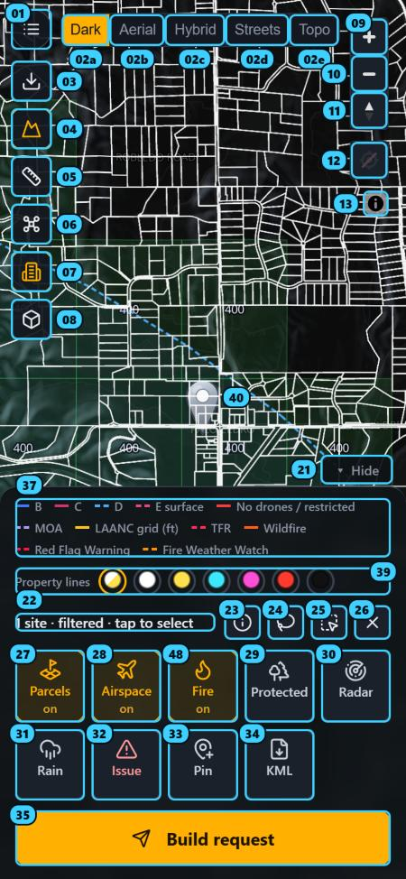

**Top and left side**

| Label | Icon | Name | What it is | Code |
|---|:-:|---|---|---|
| MAP-01 |  | List button | Round button, top left. Switches to the list. | `mClose` |
| MAP-02 |  | Basemap switcher | Row of five buttons across the top | `mBasemaps` |
| MAP-02a |  | Dark | Dark street map (default) | `data-bm="Dark"` |
| MAP-02b |  | Aerial | Satellite imagery | `data-bm="Aerial"` |
| MAP-02c |  | Hybrid | Imagery with roads and labels | `data-bm="Hybrid"` |
| MAP-02d |  | Streets | Light street map | `data-bm="Streets"` |
| MAP-02e |  | Topo | USGS topographic map | `data-bm="Topo"` |
| MAP-03 |  | Save offline | Download icon. Opens **OFF**. | `mSave` |
| MAP-04 |  | 3D terrain | Mountain icon. Turns terrain relief on and off. Amber when on. | `mTerr` |
| MAP-05 |  | Measure | Ruler icon. Starts measuring (**MAP-51**). | `mMeasure` |
| MAP-06 |  | Flyability (map center) | Drone icon. Opens **FLY** for the middle of the map. | `mFly` |
| MAP-07 |  | 3D buildings | Building icon. Amber when on. | `mBldg` |
| MAP-08 |  | 3D view | Cube icon. Opens **V3D** for the middle of the map. | `m3d` |

**Right side** (these are MapLibre's built-in controls)

| Label | Icon | Name | What it is | Code |
|---|:-:|---|---|---|
| MAP-09 |  | Zoom in | + button | MapLibre NavigationControl |
| MAP-10 |  | Zoom out | − button | MapLibre NavigationControl |
| MAP-11 |  | Compass | Arrow. Tap to face north; it also shows tilt. | MapLibre NavigationControl |
| MAP-12 |  | Locate me | Crosshair. Shows and follows your position. | `geoCtrl` (GeolocateControl) |
| MAP-13 |  | Map credits | Small (i). Opens the data credits. | MapLibre AttributionControl |

**Bottom panel (the dock)**

| Label | Icon | Name | What it is | Code |
|---|:-:|---|---|---|
| MAP-20 |  | Dock | The whole bottom panel | `mapDock` |
| MAP-21 |  | Hide / Show | Tab on top of the dock. Folds it away or brings it back. | `dockToggle` |
| MAP-22 |  | Site count | "4 sites · tap to select", or how many are selected | `mNote` |
| MAP-23 |  | Pin colors | (i) button. Shows **MAP-36**. | `mLegendBtn` |
| MAP-24 |  | Lasso | Draw around sites to select them | `mLasso` |
| MAP-25 |  | Select visible | Selects every site on screen | `mSelVis` |
| MAP-26 |  | Clear selection | × button | `mClear` |
| MAP-27 |  | Parcels | Property lines layer. Shows from about zoom 12. | `mParcels` |
| MAP-28 |  | Airspace | FAA airspace, LAANC grid and TFRs (pink dashed). TFRs show from about zoom 6. | `mAirspace` |
| MAP-48 |  | Fire | Wildfires and perimeters (NIFC, orange) plus Red Flag Warnings and Fire Weather Watches (NWS, dashed red / orange zones). Shows from about zoom 5. | `mFire` |
| MAP-29 |  | Protected | Parks, wildlife and protected areas layer | `mEnv` |
| MAP-30 |  | Radar | Weather radar layer | `mRadar` |
| MAP-31 |  | Rain | Rain forecast layer | `mRain` |
| MAP-32 |  | Issue | Flags the selected sites as access issues. Opens **ISSUE**. | `mFlag` |
| MAP-33 |  | Pin | Drops a custom pin. Shows **MAP-50**, then **PIN**. | `mPin` |
| MAP-34 |  | KML | Exports the shown or selected sites as KML | `mExport` |
| MAP-35 |  | Build request | Big amber button. Builds the access request (**REQ**). | `mReq` |
| MAP-36 |  | Pin color legend | New, Texted, Replied, Scheduled, Access issue | `mLegend` |
| MAP-37 |  | Layer legend | Key for whichever of **MAP-28**, **MAP-29** and **MAP-48** are on | `ovLegend` |
| MAP-38 |  | Weather bar | Radar or rain time and status line | `wxBar` |
| MAP-39 |  | Property line colors | Row of color dots above the site count while **MAP-27** is on: Auto, White, Yellow, Cyan, Magenta, Red, Black | `pcLegend` |

**Things on the map**

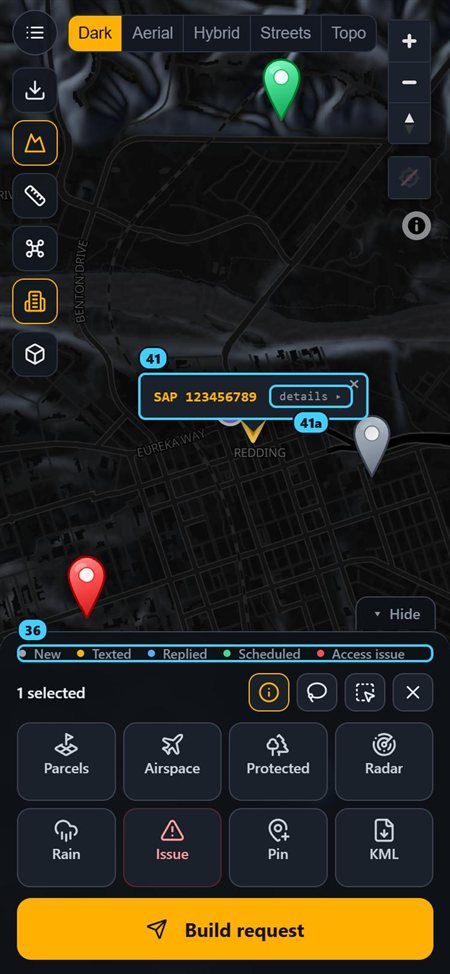 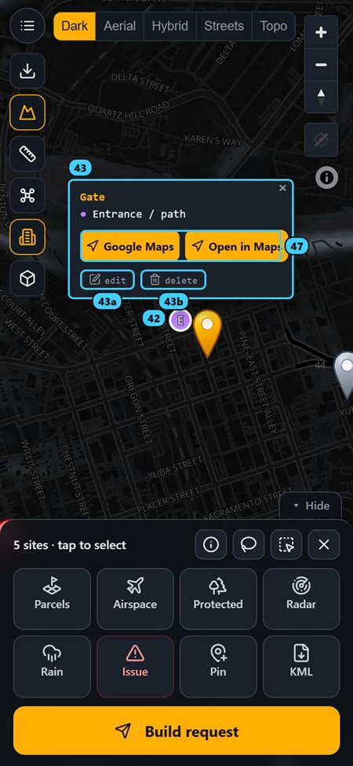 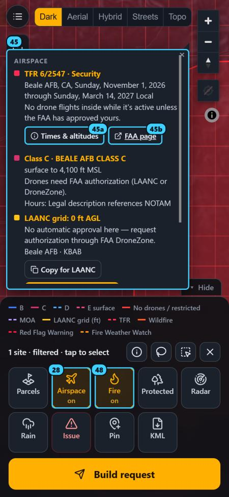

The third screenshot is the layer popup (**MAP-45**) inside the Beale AFB TFR.

| Label | Icon | Name | What it is | Code |
|---|:-:|---|---|---|
| MAP-40 |  | Site pin | One site, colored by status. Its shape and size come from **SET-40** and **SET-41**. | `cmap` pins layer |
| MAP-41 |  | Site popup | Small bubble when you tap a site pin | `showPinPopup` |
| MAP-41a |  | details ▸ | Inside **MAP-41**. Expands to name, issue and access notes. Long notes scroll inside the popup, and the map moves so the whole popup shows above the bottom panel. | `.popmore` |
| MAP-41b |  | Flyability here | Inside the expanded **MAP-41**. Opens **FLY** for the site. | `data-fly` |
| MAP-41c |  | 3D view | Inside the expanded **MAP-41**. Opens **V3D**. | `data-v3d` |
| MAP-41d |  | Nearest hospital | Inside the expanded **MAP-41**. Opens **HOSP** for the site. | `data-hosp` |
| MAP-42 |  | Custom pin | A pin you dropped (gate, path, hazard…) | `userPins` |
| MAP-43 |  | Custom pin popup | Bubble for **MAP-42** | `showUserPinPopup` |
| MAP-43a |  | edit | Inside **MAP-43**. Opens **PIN**. | `data-pact="edit"` |
| MAP-43b |  | delete | Inside **MAP-43** | `data-pact="del"` |
| MAP-43c |  | hospital | Inside **MAP-43**. Opens **HOSP** for the pin. | `data-hosp` |
| MAP-44 |  | Parcel popup | Owner and parcel info when **MAP-27** is on | `showParcelPopup` |
| MAP-45 |  | Layer popup | What's at the spot you tapped: Airspace (with TFRs), Fire and Protected sections for the layers that are on | `openOverlayPopup` |
| MAP-45a |  | Times & altitudes | On a TFR in **MAP-45**. Loads its active times (your time), floor and ceiling, and the NOTAM text. | `data-tfr` |
| MAP-45b |  | FAA page | On a TFR in **MAP-45**. Opens the TFR on tfr.faa.gov. | `tfr.faa.gov` link |
| MAP-45c |  | Check NOTAMs | Bottom of **MAP-45** when Airspace is on. Copies the spot's coordinates and opens FAA NOTAM Search; names the nearest airport when it knows it. | `data-notam` |
| MAP-46 |  | Lasso drawing | The line you draw with **MAP-24** | `lassoLayer` |
| MAP-47 |  | Directions buttons | "Google Maps" and "Open in Maps" inside **MAP-41**, **MAP-43** and **MAP-44** | `navLinks` |

**Banners on the map**

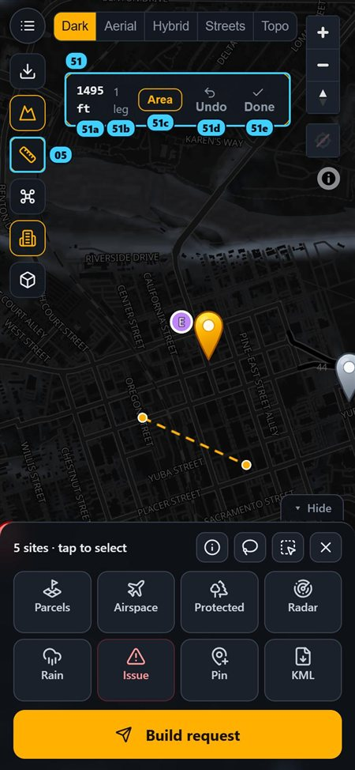 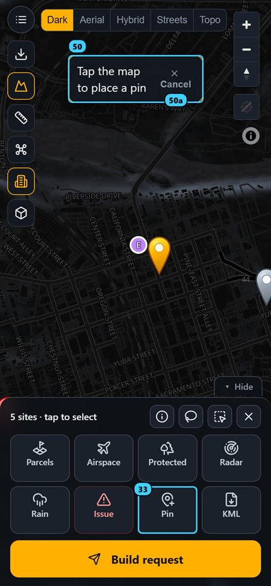

| Label | Icon | Name | What it is | Code |
|---|:-:|---|---|---|
| MAP-50 |  | Place-pin banner | "Tap the map to place a pin" | `pinBanner` |
| MAP-50a |  | Cancel | Inside **MAP-50** | `pinCancel` |
| MAP-51 |  | Measure banner | Shows while **MAP-05** is on | `measBanner` |
| MAP-51a |  | Measurement | The distance or area reading | `measVal` |
| MAP-51b |  | Hint | Instructions such as "tap points", then a count such as "2 legs". On a phone the count is hidden to save room. | `measHint` |
| MAP-51c |  | Area / Distance | Switches between measuring an area and a distance | `measModeBtn` |
| MAP-51d |  | Undo | Removes the last point | `measUndo` |
| MAP-51e |  | Done | Stops measuring | `measX` |

## OFF: Save offline panel

Opened by **MAP-03**. It sits on top of the map. Left: **This view**. Right: **A mission**.

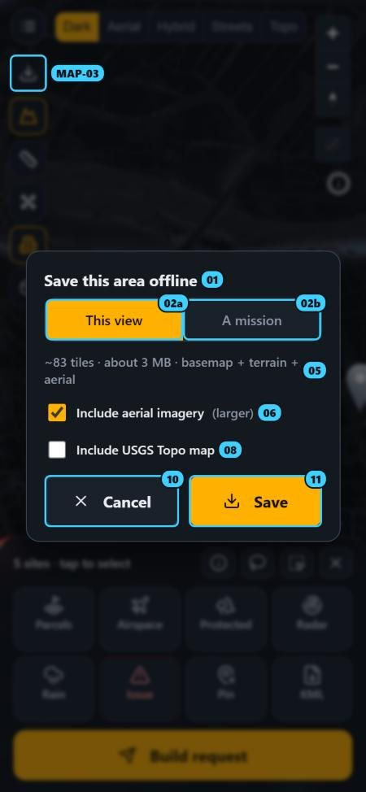 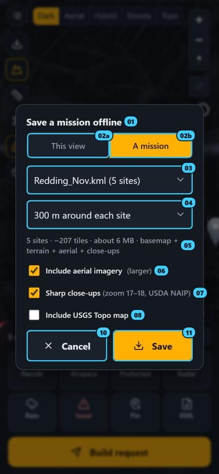

| Label | Icon | Name | What it is | Code |
|---|:-:|---|---|---|
| OFF-01 |  | Title | "Save this area offline", or "Save a mission offline" with **OFF-02b** | `dlTitle` |
| OFF-02 |  | What to save | Two-way switch | `dlMode` |
| OFF-02a |  | This view | What's on screen | `data-m="view"` |
| OFF-02b |  | A mission | The map around every site in a mission | `data-m="mission"` |
| OFF-03 |  | Mission | Picks the mission (only with **OFF-02b**) | `dlMis` |
| OFF-04 |  | Map around each site | 150 m, 300 m, 800 m or 2 km (only with **OFF-02b**) | `dlBuf` |
| OFF-05 |  | Size estimate | Tiles and megabytes, or "Preparing…" | `dlSub` |
| OFF-06 |  | Include aerial imagery | Checkbox | `dlAerial` |
| OFF-07 |  | Sharp close-ups | Checkbox. Zoom 17–18 from USDA NAIP. Only with **OFF-02b**. | `dlNaip` |
| OFF-08 |  | Include USGS Topo map | Checkbox | `dlTopo` |
| OFF-09 |  | Progress bar | Fills while saving | `dlBar` |
| OFF-10 |  | Cancel | Closes the panel, or stops a save in progress | `dlCancel` |
| OFF-11 |  | Save | Starts the download | `dlGo` |

---

## HDR: Top bar

Shown above the list. The map screen covers it. Its tags are in the list screenshot below.

| Label | Icon | Name | What it is | Code |
|---|:-:|---|---|---|
| HDR-01 |  | FieldKey logo | Pin icon and name, top left | `header .bar` |
| HDR-02 |  | Sync status | Only when signed in. Shows "Synced", "Syncing", "3 to sync", "Offline" or "2 not synced". Tap it to sync now. | `syncBtn` |
| HDR-03 |  | Flyability | Drone icon. Opens **FLY** for your location. | `flyBtn` |
| HDR-04 |  | Settings | Gear icon. Opens **SET**. | `settingsBtn` |

## LIST: List

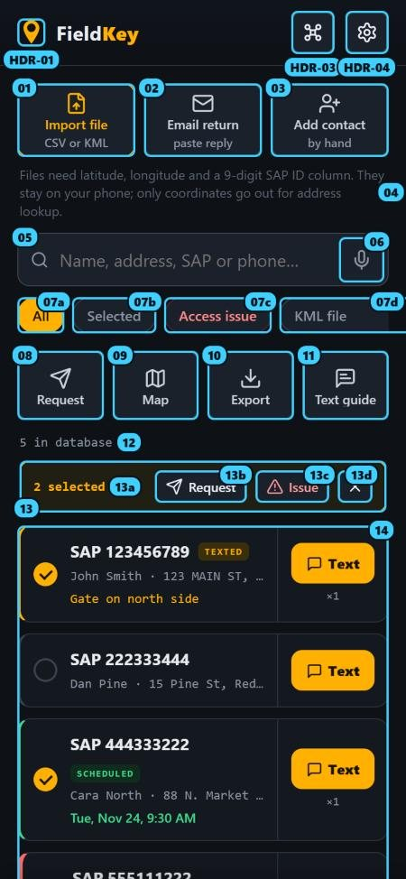

The top bar (**HDR**) is tagged here too.

| Label | Icon | Name | What it is | Code |
|---|:-:|---|---|---|
| LIST-01 |  | Import file | Tile. Pick a CSV or KML; opens **IMP**. | `impDrop` |
| LIST-02 |  | Email return | Tile. Opens **EMAIL**. | `pasteEmailBtn` |
| LIST-03 |  | Add contact | Tile. Opens **ADD**. | `addContactBtn` |
| LIST-04 |  | File note | Grey line about the columns a file needs | `.homenote` |
| LIST-05 |  | Search box | Searches name, address, SAP ID and phone | `custSearch` |
| LIST-06 |  | Voice search | Mic inside **LIST-05**. Turns red while listening. | `custMic` |
| LIST-07 |  | Filter chips | Row of filters; it scrolls sideways | `custFilters` |
| LIST-07a |  | All | | `data-f="all"` |
| LIST-07b |  | Selected | | `data-f="selected"` |
| LIST-07c |  | Access issue | Red chip | `data-f="accessissue"` |
| LIST-07d |  | KML file | Dropdown. Shows one imported file. Says "No files yet" until you import one. | `custKml` |
| LIST-07e |  | Has contact | | `data-f="has"` |
| LIST-07f |  | Not texted | | `data-f="nottexted"` |
| LIST-07g |  | Texted | | `data-f="texted"` |
| LIST-07h |  | Replied | | `data-f="replied"` |
| LIST-07i |  | Scheduled | | `data-f="scheduled"` |
| LIST-08 |  | Request | Tile. Builds the access request (**REQ**). | `buildReqBtn` |
| LIST-09 |  | Map | Tile. Back to **MAP**. | `mapBtn` |
| LIST-10 |  | Export | Tile. Opens **EXP**. | `exportCustBtn` |
| LIST-11 |  | Text guide | Tile. Starts guided texting (**GUIDE**). | `textAllBtn` |
| LIST-12 |  | Database count | "4 in database" | `dbCount` |
| LIST-13 |  | Selection bar | Shows when you select rows | `selBar` |
| LIST-13a |  | Selected count | "2 selected" | `selCount` |
| LIST-13b |  | Request | Request for the selected sites | `selBuild` |
| LIST-13c |  | Issue | Flags the selected sites. Opens **ISSUE**. | `selFlag` |
| LIST-13d |  | Clear | × clears the selection | `selClear` |
| LIST-14 |  | Site list | The cards; each one is a **ROW** | `custList` |
| LIST-15 |  | Empty message | "Nothing here yet…" when the list is empty | `custEmpty` |

## ROW: One site in the list

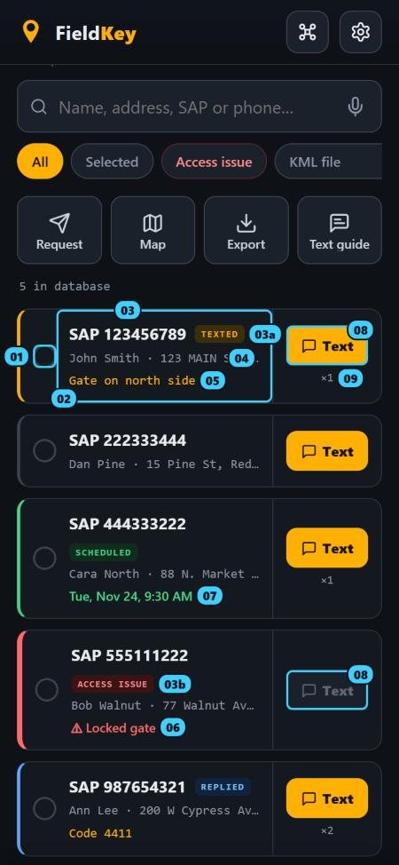

| Label | Icon | Name | What it is | Code |
|---|:-:|---|---|---|
| ROW-01 |  | Select circle | Left edge. Selects the site. | `.csel` |
| ROW-02 |  | Card body | Tap to open **SITE** | `.cmain` |
| ROW-03 |  | Title | SAP ID or name, with badges | `.cname` |
| ROW-03a |  | Status badge | texted, replied, scheduled, done | `.cstat` |
| ROW-03b |  | ACCESS ISSUE badge | Red | `.cstat.issue` |
| ROW-04 |  | Name and address line | Grey line under the title | `.cmeta` |
| ROW-05 |  | Access line | Gate code, access notes | `.caxs` |
| ROW-06 |  | Issue reason | Red ⚠ line | `.cissue` |
| ROW-07 |  | Scheduled time | Green line | `.csched` |
| ROW-08 |  | Text button | Amber. Grey when there's no phone number. | `.textbtn` |
| ROW-09 |  | Texts sent count | "×2" next to **ROW-08** | `.ccount` |

## GUIDE: Guided texting bar

Slides up from the bottom after **LIST-11**.

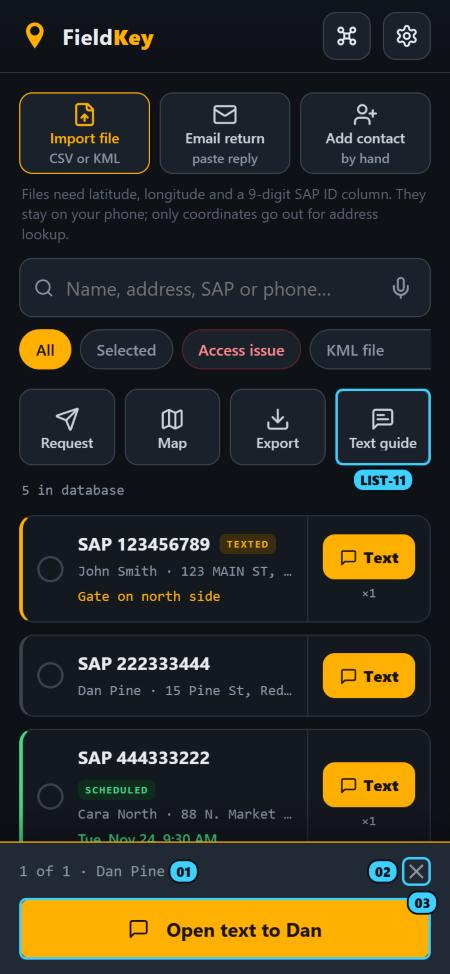

| Label | Icon | Name | What it is | Code |
|---|:-:|---|---|---|
| GUIDE-01 |  | Progress | Which customer you're on, for example "2 of 7 · Jane Doe" | `guideLabel` |
| GUIDE-02 |  | Stop | × top right | `guideClose` |
| GUIDE-03 |  | Open text | "Open text to Dan". Opens the next text in Messages. | `guideOpen` |

---

## SITE: Site details

Sheet that slides up from the bottom. Right: the access issue box on a flagged site.

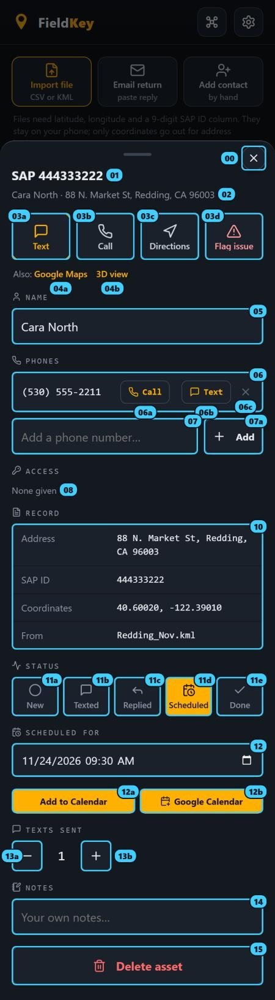 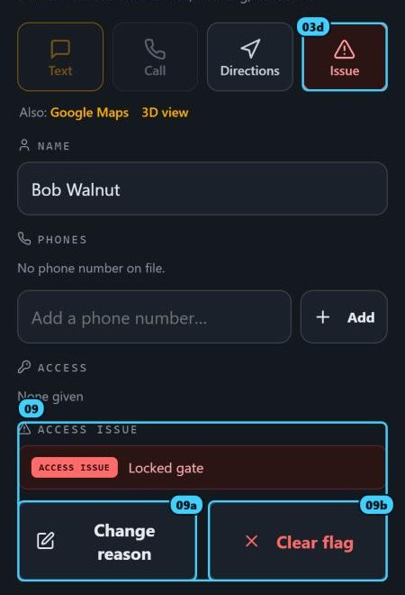

| Label | Icon | Name | What it is | Code |
|---|:-:|---|---|---|
| SITE-01 |  | Title | SAP ID or name | `dName` |
| SITE-02 |  | Subtitle | Name and address | `dMeta` |
| SITE-03 |  | Action tiles | Row of four tiles | `dActions` |
| SITE-03a |  | Text | | `dTextBtn` |
| SITE-03b |  | Call | | `dCallT` |
| SITE-03c |  | Directions | Opens the phone's own maps app | `dDirT` |
| SITE-03d |  | Flag issue | Red tile. Opens **ISSUE**. Says "Issue" once the site is flagged. | `dIssueT` |
| SITE-04 |  | "Also:" links | Under the tiles | `dNav` |
| SITE-04a |  | Google Maps | Directions in Google Maps | `dNav a` |
| SITE-04b |  | 3D view | Opens **V3D** for this site | `data-v3dsite` |
| SITE-04c |  | Nearest hospital | Opens **HOSP** for this site | `data-hospsite` |
| SITE-05 |  | Name | Editable | `dNameEdit` |
| SITE-06 |  | Phones | One line for each number | `dPhones` |
| SITE-06a |  | Call | On each phone line | `dPhones a[href^=tel]` |
| SITE-06b |  | Text | On each phone line | `data-sms` |
| SITE-06c |  | Remove number | × on each phone line | `data-phrm` |
| SITE-07 |  | Add a phone number | Field | `dAddPhone` |
| SITE-07a |  | Add | Button next to **SITE-07** | `dAddPhoneBtn` |
| SITE-08 |  | Access | Access value and gate-code box | `dAccess` |
| SITE-09 |  | Access issue box | Only when flagged. Badge and reason. | `dIssueGroup` |
| SITE-09a |  | Change reason | Opens **ISSUE** | `dIssueChange` |
| SITE-09b |  | Clear flag | | `dIssueClear` |
| SITE-10 |  | Record | SAP ID, coordinates, source file and similar | `dInfo` |
| SITE-11 |  | Status | Five buttons | `dStatus` |
| SITE-11a |  | New | | `data-s="enriched"` |
| SITE-11b |  | Texted | | `data-s="texted"` |
| SITE-11c |  | Replied | | `data-s="replied"` |
| SITE-11d |  | Scheduled | Shows **SITE-12** | `data-s="scheduled"` |
| SITE-11e |  | Done | | `data-s="done"` |
| SITE-12 |  | Scheduled for | Date and time (only when Scheduled) | `dSched` |
| SITE-12a |  | Apple Calendar | Says "Add to Calendar" on Android | `dCalIcs` |
| SITE-12b |  | Google Calendar | | `dCalGoogle` |
| SITE-13 |  | Texts sent | Counter | `dCounter` |
| SITE-13a |  | − | One fewer | `dMinus` |
| SITE-13b |  | + | One more | `dPlus` |
| SITE-14 |  | Notes | Your own notes | `dNotes` |
| SITE-15 |  | Delete asset | Red button at the bottom | `dDelete` |

## ISSUE: Access issue reason

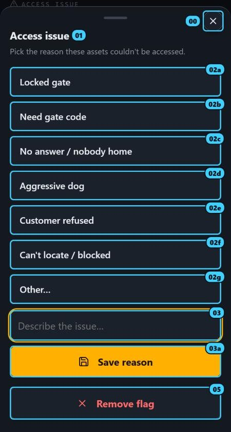

| Label | Icon | Name | What it is | Code |
|---|:-:|---|---|---|
| ISSUE-01 |  | Title | "Access issue" | `riTitle` |
| ISSUE-02 |  | Reasons | One button for each reason | `riReasons` |
| ISSUE-02a |  | Locked gate | | |
| ISSUE-02b |  | Need gate code | | |
| ISSUE-02c |  | No answer / nobody home | | |
| ISSUE-02d |  | Aggressive dog | | |
| ISSUE-02e |  | Customer refused | | |
| ISSUE-02f |  | Can't locate / blocked | | |
| ISSUE-02g |  | Other… | Shows **ISSUE-03** | `data-other` |
| ISSUE-03 |  | Describe the issue | Field (after **ISSUE-02g**) | `riOther` |
| ISSUE-03a |  | Save reason | | `riOtherSave` |
| ISSUE-04 |  | Flag now, set reason later | Only when flagging a site that isn't flagged yet | `riLater` |
| ISSUE-05 |  | Remove flag | | `riRemove` |

## IMP: Import file

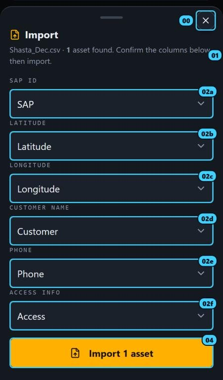

| Label | Icon | Name | What it is | Code |
|---|:-:|---|---|---|
| IMP-01 |  | File info | File name and row count | `impInfo` |
| IMP-02 |  | Column pickers | Which column holds what | `impCols` |
| IMP-02a |  | SAP ID | | `impSap` |
| IMP-02b |  | Latitude | | `impLat` |
| IMP-02c |  | Longitude | | `impLng` |
| IMP-02d |  | Customer name | | `impNameC` |
| IMP-02e |  | Phone | | `impPhone` |
| IMP-02f |  | Access info | | `impAccess` |
| IMP-03 |  | Progress | Bar and count while importing | `impProgWrap` |
| IMP-03a |  | Cancel | Stops the import | `impCancel` |
| IMP-04 |  | Import | Starts the import | `impGo` |

## EMAIL: Import return email

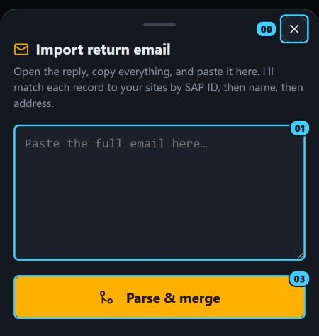

| Label | Icon | Name | What it is | Code |
|---|:-:|---|---|---|
| EMAIL-01 |  | Email text | Paste box | `eText` |
| EMAIL-02 |  | Result | What matched | `eStat` |
| EMAIL-03 |  | Parse & merge | | `eParse` |

## ADD: Add contact

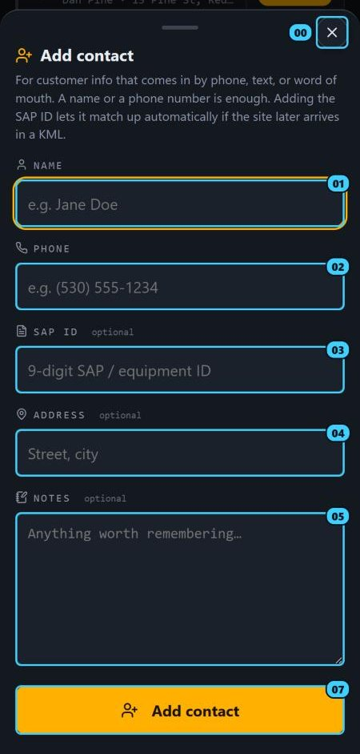

| Label | Icon | Name | What it is | Code |
|---|:-:|---|---|---|
| ADD-01 |  | Name | | `acName` |
| ADD-02 |  | Phone | | `acPhone` |
| ADD-03 |  | SAP ID | Optional | `acSap` |
| ADD-04 |  | Address | Optional | `acAddr` |
| ADD-05 |  | Notes | Optional | `acNotes` |
| ADD-06 |  | Message | What to fix, such as a missing name or phone | `acStat` |
| ADD-07 |  | Add contact | | `acSave` |

## REQ: Access requests

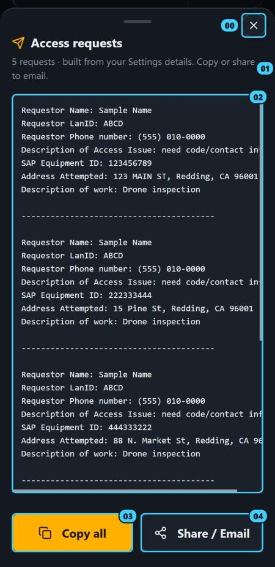

| Label | Icon | Name | What it is | Code |
|---|:-:|---|---|---|
| REQ-01 |  | Summary | How many requests | `rqInfo` |
| REQ-02 |  | Request text | Read-only text of every request | `rqText` |
| REQ-03 |  | Copy all | | `rqCopy` |
| REQ-04 |  | Share / Email | | `rqShare` |

## EXP: Export

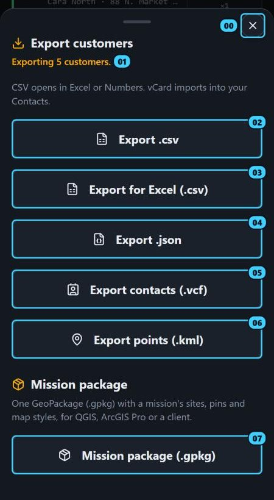

| Label | Icon | Name | What it is | Code |
|---|:-:|---|---|---|
| EXP-01 |  | Scope | Which sites will be exported (all, filtered or selected) | `xScope` |
| EXP-02 |  | Export .csv | | `xCsv` |
| EXP-03 |  | Export for Excel (.csv) | | `xXlsxCsv` |
| EXP-04 |  | Export .json | | `xJson` |
| EXP-05 |  | Export contacts (.vcf) | | `xVcf` |
| EXP-06 |  | Export points (.kml) | | `xKml` |
| EXP-07 |  | Mission package (.gpkg) | Opens **PKG** | `xPkg` |

## PKG: Mission package

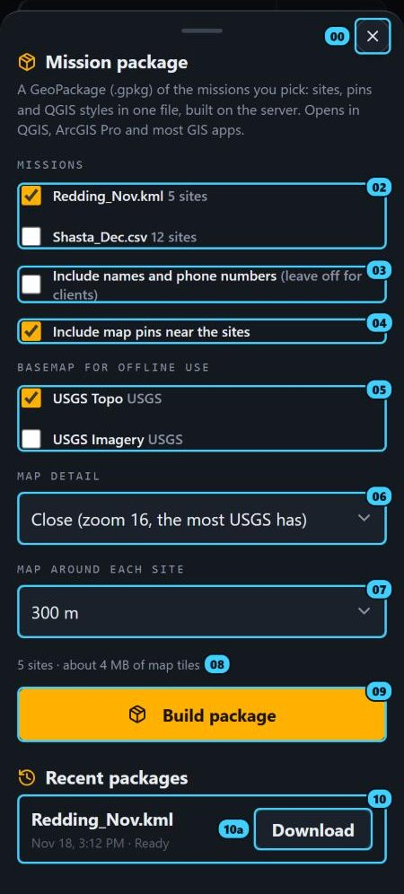

This is the signed-in view with sample missions. Signed out, the sheet shows only the sign-in note (**PKG-01**).

| Label | Icon | Name | What it is | Code |
|---|:-:|---|---|---|
| PKG-01 |  | Sign-in note | Only when signed out | `mpSignedOut` |
| PKG-02 |  | Missions | Checkbox for each mission | `mpMissions` |
| PKG-03 |  | Include names and phone numbers | Checkbox | `mpContacts` |
| PKG-04 |  | Include map pins near the sites | Checkbox | `mpPins` |
| PKG-05 |  | Basemap for offline use | Checkbox for each basemap | `mpBasemaps` |
| PKG-06 |  | Map detail | Zoom 14, 15 or 16 | `mpZoom` |
| PKG-07 |  | Map around each site | 150 m to 2 km | `mpBuffer` |
| PKG-08 |  | Size estimate | | `mpEst` |
| PKG-09 |  | Build package | | `mpGo` |
| PKG-10 |  | Recent packages | List of packages already built | `mpJobs` |
| PKG-10a |  | Download | On a finished package | `.mpdl` |
| PKG-10b |  | Cancel | On a package still building | `.mpcx` |

## PIN: Map pin

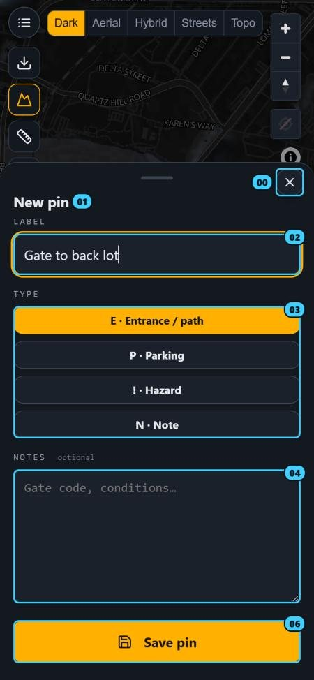

| Label | Icon | Name | What it is | Code |
|---|:-:|---|---|---|
| PIN-01 |  | Title | "New pin" or "Edit pin" | `pinTitle` |
| PIN-02 |  | Label | Pin name | `pLabel` |
| PIN-03 |  | Type | One button for each pin type | `pTypes` |
| PIN-04 |  | Notes | | `pNotes` |
| PIN-05 |  | Delete | Only when editing | `pDelete` |
| PIN-06 |  | Save pin | | `pSave` |

## SET: Settings

Long sheet, shown here in three parts from top to bottom. The requestor details are sample values.

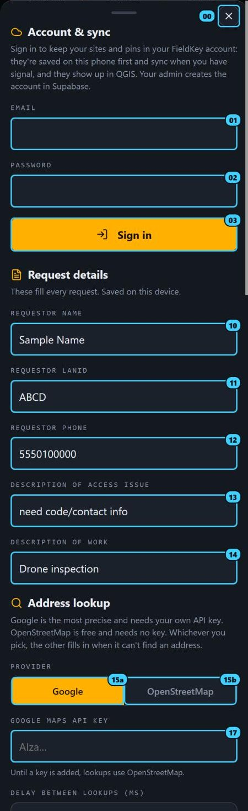 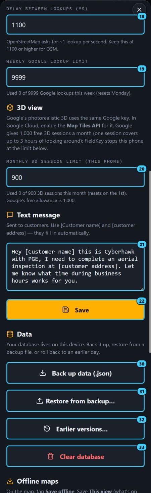 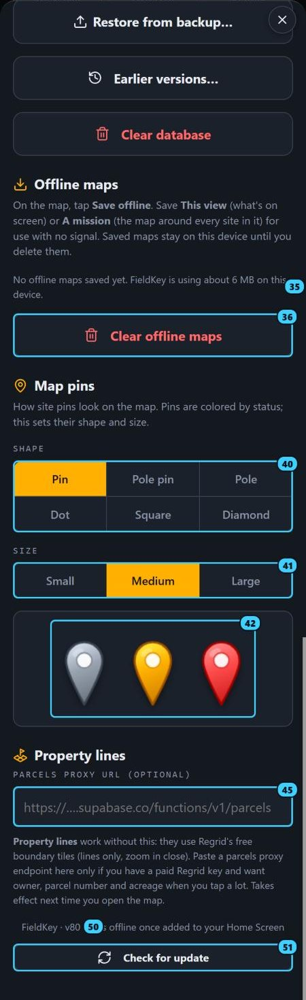

**Account & sync**

| Label | Icon | Name | What it is | Code |
|---|:-:|---|---|---|
| SET-01 |  | Email | Signed out | `sAcctEmail` |
| SET-02 |  | Password | Signed out | `sAcctPw` |
| SET-03 |  | Sign in | Signed out | `sSignIn` |
| SET-04 |  | Signed in as | Signed in | `sAcctWho` |
| SET-05 |  | Sync status line | "Last sync…", waiting or failed counts | `sAcctStat` |
| SET-06 |  | Sync now | | `sSyncNow` |
| SET-07 |  | Retry failed | Only when something failed | `sRetryFailed` |
| SET-08 |  | Mission package | Opens **PKG** | `sPkg` |
| SET-09 |  | Sign out | | `sSignOut` |

**Request details**

| Label | Icon | Name | What it is | Code |
|---|:-:|---|---|---|
| SET-10 |  | Requestor name | | `sName` |
| SET-11 |  | Requestor LanID | | `sLan` |
| SET-12 |  | Requestor phone | | `sPhone` |
| SET-13 |  | Description of access issue | | `sIssue` |
| SET-14 |  | Description of work | | `sWork` |

**Address lookup**

| Label | Icon | Name | What it is | Code |
|---|:-:|---|---|---|
| SET-15 |  | Provider | Two-way switch | `segProvider` |
| SET-15a |  | Google | | `data-v="google"` |
| SET-15b |  | OpenStreetMap | | `data-v="osm"` |
| SET-16 |  | Contact email | OSM only | `sEmail` |
| SET-17 |  | Google Maps API key | Google only | `sGkey` |
| SET-18 |  | Delay between lookups | | `sDelay` |
| SET-19 |  | Weekly Google lookup limit | | `sGeoLimit` |

**3D view, text message, save**

| Label | Icon | Name | What it is | Code |
|---|:-:|---|---|---|
| SET-20 |  | Monthly 3D session limit | | `s3dLimit` |
| SET-21 |  | Text message template | Uses [Customer name] and [customer address] | `sSms` |
| SET-22 |  | Save | Saves **SET-10** to **SET-21** | `saveSettings` |

**Data**

| Label | Icon | Name | What it is | Code |
|---|:-:|---|---|---|
| SET-30 |  | Back up data (.json) | | `sBackup` |
| SET-31 |  | Restore from backup… | | `sRestoreFile` |
| SET-32 |  | Earlier versions… | Opens **VER** | `sVersions` |
| SET-33 |  | Clear database | | `sClearDb` |

**Offline maps**

| Label | Icon | Name | What it is | Code |
|---|:-:|---|---|---|
| SET-35 |  | Saved maps list | One line for each saved area | `offlineList` |
| SET-35a |  | Delete | On each saved map | `.offdel` |
| SET-36 |  | Clear offline maps | | `sClearMaps` |

**Map pins**

| Label | Icon | Name | What it is | Code |
|---|:-:|---|---|---|
| SET-40 |  | Pin shape | Pin, Pole pin, Pole, Dot, Square, Diamond | `segPinShape` |
| SET-41 |  | Pin size | Small, Medium, Large | `segPinSize` |
| SET-42 |  | Pin preview | Picture of the chosen pin | `pinPreview` |

**Property lines, version**

| Label | Icon | Name | What it is | Code |
|---|:-:|---|---|---|
| SET-45 |  | Parcels proxy URL | Optional | `sParcelsProxy` |
| SET-46 |  | Line color | Same choices as **MAP-39**. Auto: white on Dark, yellow on Aerial, cyan on Hybrid, magenta on Streets and Topo. | `segParcelColor` |
| SET-50 |  | Version line | "FieldKey · v82 · …" | `sAppVer` |
| SET-51 |  | Check for update | | `sCheckUpdate` |

## HOSP: Nearest hospitals

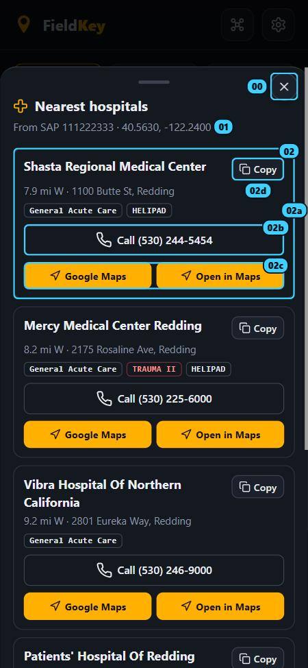

The five closest open hospitals that may treat an injury (general acute care, critical access, children's, military), nearest first. Data: FEMA's copy of the national hospitals list (HIFLD). It has no "has an ER" flag, so call ahead. Each list is saved on the phone and shown again offline for the same area.

| Label | Icon | Name | What it is | Code |
|---|:-:|---|---|---|
| HOSP-00 |  | Close | | `.sheetclose` |
| HOSP-01 |  | From | The site or pin and its coordinates | `hFrom` |
| HOSP-02 |  | Hospital card | Name, straight-line miles and direction, address | `.hrow` |
| HOSP-02a |  | Badges | Type, trauma level, helipad | `.hbadges` |
| HOSP-02b |  | Call | Calls the hospital | `.hcall` |
| HOSP-02c |  | Directions | "Google Maps" and "Open in Maps", as in **MAP-47** | `.navrow` |
| HOSP-02d |  | Copy | Copies the hospital's name, to paste into a message or your notes | `data-hcopy` |
| HOSP-03 |  | Note | Straight-line distance, call ahead, call 911 | `hNote` |

## VER: Earlier versions

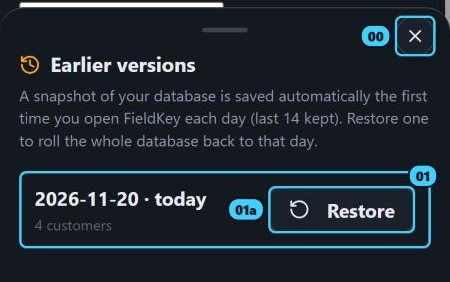

| Label | Icon | Name | What it is | Code |
|---|:-:|---|---|---|
| VER-01 |  | Snapshot list | One line for each day (last 14) | `verList` |
| VER-01a |  | Restore | On each day | `.vrestore` |

## FLY: Flyability · V3D: 3D view

Both are full-screen pages with a bar across the top. **V3D** looks the same, with the 3D scene in place of the weather.

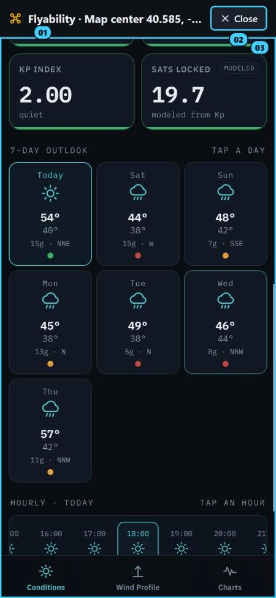

| Label | Icon | Name | What it is | Code |
|---|:-:|---|---|---|
| FLY-01 |  | Title | Place name | `flyTitle` |
| FLY-02 |  | Close | | `flyClose` |
| FLY-03 |  | Weather page | The drone weather itself | `flyFrame` |
| V3D-01 |  | Title | Place name | `v3Title` |
| V3D-02 |  | Close | | `v3Close` |
| V3D-03 |  | 3D scene | Google photorealistic 3D | `v3Frame` |

## TOAST

| Label | Icon | Name | What it is | Code |
|---|:-:|---|---|---|
| TOAST |  | Toast | Short message at the bottom, such as "Pin deleted". It goes away by itself. | `toast` |

---

## Hidden parts (not reachable in the app)

These are still in `index.html`, but nothing in the app opens them. They have no labels. Ask if you want them removed.

- The old **Requests** screen (`viewRequests`): steps 01–05 (load file, site map, confirm columns, build, results) and its export dock.
- The bottom **tab bar** (`tabbar`) with Requests and Customers.
- The **Save to Customers** sheet (`kSheet`), which only the old Requests screen opened.
